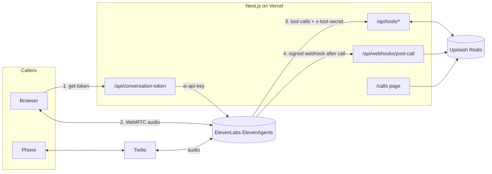

# Oneroa Bay Kayaks: an ElevenAgents voice booking demo

A voice agent for a made-up kayak-hire business on Waiheke Island. Callers can talk to it **in the browser** or **by phone**. It checks live availability, makes bookings through server tools, and logs every call through a signed post-call webhook.

Built with [ElevenLabs ElevenAgents](https://elevenlabs.io/docs/agents-platform/overview), Next.js 16 on Vercel, Twilio and Upstash Redis.

**Live demo:** _add your Vercel URL_ · **Phone:** _add your Twilio number_

## What it shows

| Piece | Where | What it does |
| --- | --- | --- |
| Web voice client | `src/components/VoiceAgent.tsx` | `@elevenlabs/react` over WebRTC, live transcript, text fallback, mic-permission handling |
| Conversation token | `src/app/api/conversation-token` | Issues short-lived tokens so the API key never reaches the browser; per-IP rate limit |
| Server tools | `src/app/api/tools/*` | `check_availability` and `create_booking`, shared-secret auth, recoverable errors, no overbooking under concurrency |
| Post-call webhook | `src/app/api/webhooks/post-call` | HMAC-SHA256 signature check on the raw body, timing-safe compare, replay window |
| Call log | `/calls` | Summary, outcome, tools used and transcript for each call |
| Phone | Twilio, connected in the ElevenLabs dashboard | Same agent, same tools, reachable by a real number |
| Agent config | `agent/` | System prompt and tool definitions, kept in version control |

## Architecture



Real-time audio never passes through Vercel. Browsers talk to ElevenLabs over WebRTC, and Twilio streams phone audio straight to ElevenLabs. Vercel only handles short HTTP requests, which suits serverless functions. Serverless functions can't hold long-lived WebSocket connections, so a custom Twilio Media Streams bridge would need a long-running host such as Fly.io or Railway instead.

## Setup

### 1. Run locally

```bash
npm install
cp .env.example .env.local   # fill in during later steps
npm run dev
npm test                      # unit tests: signature checks, booking rules
```

### 2. Create the agent in ElevenLabs

1. **ElevenAgents → Create agent → Blank.**
2. Paste `agent/system-prompt.md` into the system prompt. Set the first message to: _"Kia ora, Oneroa Bay Kayaks, Kai speaking. How can I help?"_
3. Set the agent's **timezone to Pacific/Auckland** so `{{system__time}}` gives NZ time.
4. Pick a voice and an LLM.
5. Under **Security**, turn on **Authentication**. The browser then needs a token from this server, so nobody can use the agent ID alone to run up your bill.
6. Set a **maximum conversation duration** (e.g. 5 minutes).
7. Under **Analysis**, add a success criterion such as _"A booking was created or the caller's question was answered."_ This gives the call log its success/failure label.
8. Copy the Agent ID into `ELEVENLABS_AGENT_ID` and create an API key for `ELEVENLABS_API_KEY`.

### 3. Deploy to Vercel

```bash
vercel                                     # first deploy, links the project
vercel env add ELEVENLABS_API_KEY
vercel env add ELEVENLABS_AGENT_ID
vercel env add TOOL_SECRET                 # openssl rand -hex 32
vercel env add ELEVENLABS_WEBHOOK_SECRET   # after step 5
vercel --prod
```

For persistent bookings and call logs, add **Upstash Redis** from the Vercel Marketplace (Storage tab). It sets the env vars for you. Without it the app falls back to in-memory storage, which resets between function instances.

Check `https://YOUR-APP.vercel.app/api/health`. It shows which settings are present, never their values.

### 4. Add the tools

Follow `agent/tools.md`: two webhook tools pointing at your Vercel URL, each with an `x-tool-secret` header stored as a **Secret**.

### 5. Add the post-call webhook

In ElevenLabs **Settings → Webhooks**, create a webhook pointing at `https://YOUR-APP.vercel.app/api/webhooks/post-call`. Copy its secret into `ELEVENLABS_WEBHOOK_SECRET` and redeploy. Then turn on **post-call transcription** webhooks for the agent or workspace.

Test it without making a call:

```bash
ELEVENLABS_WEBHOOK_SECRET=... node scripts/send-test-webhook.mjs https://YOUR-APP.vercel.app
```

### 6. Connect a phone number (Twilio)

1. Buy a voice-capable number in Twilio and create an API key with limited permissions.
2. In ElevenLabs **Phone Numbers → Import number → Twilio**, enter the number, API Key SID and secret.
3. Assign the agent for inbound calls. ElevenLabs configures the Twilio webhooks itself.
4. Call the number, then check `/calls`. Phone calls show the `phone` label.
5. Set `NEXT_PUBLIC_AGENT_PHONE_NUMBER` to show the number on the home page.

## Troubleshooting

Problems you're likely to hit, roughly in the order I'd check them with a customer.

| Symptom | Likely cause | How to confirm / fix |
| --- | --- | --- |
| "Talk to the agent" fails with a token error | Missing or wrong `ELEVENLABS_API_KEY` / `ELEVENLABS_AGENT_ID`, or the key lacks ElevenAgents **Write** permission (`convai_write`) | `/api/health`; Vercel function logs show the upstream status (401 = key, 404 = agent ID) |
| Mic prompt never appears | Page not served over HTTPS, or permission previously denied | Use `localhost` or the Vercel URL; reset site permissions in the browser |
| Agent says it can't reach the booking system | Wrong tool URL, `x-tool-secret` mismatch (401), or the deployment still has old env vars | Tool call details on the conversation in the ElevenLabs dashboard; Vercel logs; redeploy after changing env vars |
| Agent books the wrong day | Agent timezone not set, so `{{system__time}}` is UTC | Set the timezone to Pacific/Auckland in agent settings |
| Webhook returns 401 "Signature mismatch" | Body parsed and re-serialised before verifying, or wrong secret | Verify against `await request.text()`; run `scripts/send-test-webhook.mjs` |
| Webhook returns 401 "Timestamp outside tolerance" | Replayed or very delayed event, or server clock skew | Compare the `t=` value with server time |
| `/calls` stays empty | Post-call webhook not enabled, or in-memory store on Vercel | ElevenLabs webhook delivery logs; `/api/health` → `persistent_store` |
| Phone number won't import | Number isn't in that Twilio account, or the API key can't see it | Check the number and key belong to the same Twilio account or subaccount |

### Debugging log

_Fill this in while building: date, what broke, root cause, fix._

| Date | What broke | Root cause | Fix |
| --- | --- | --- | --- |
| | | | |

## Design notes

- **Validation errors return HTTP 200 with an `error` field.** The agent gets a plain message it can act on ("that date's in the past, did you mean…?") instead of a generic failure. Auth failures still return 401.
- **Overbooking is prevented by increment-then-check.** The slot counter goes up first and rolls back if over capacity, so two simultaneous callers can't both take the last kayaks. A test covers this.
- **The webhook verifier is hand-written** rather than taken from the server SDK, to keep dependencies small and use a timing-safe comparison. It uses the same `t=…,v0=…` HMAC-SHA256 scheme as the SDK's `webhooks.constructEvent`.
